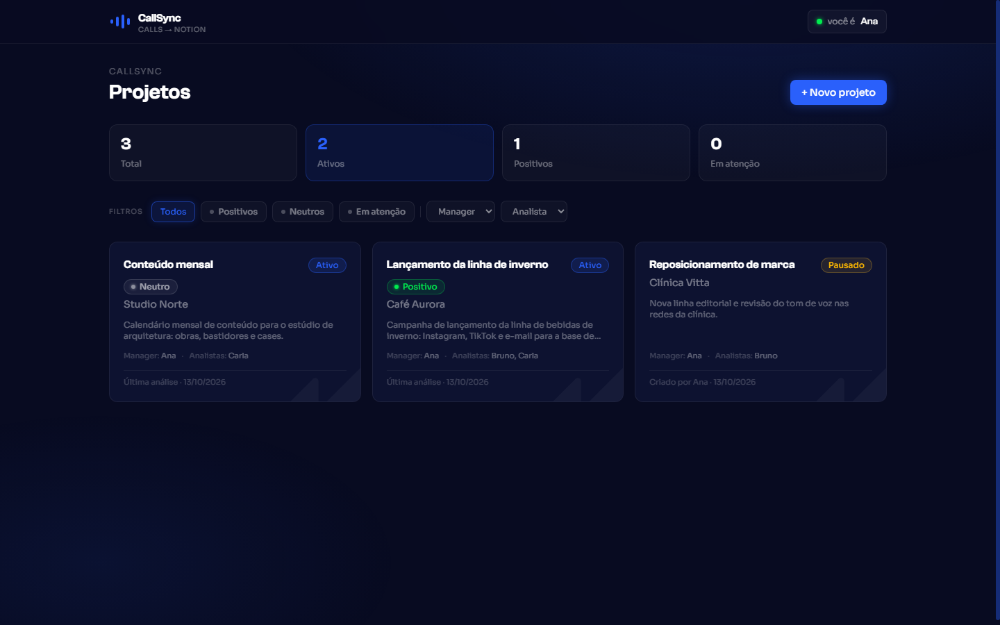
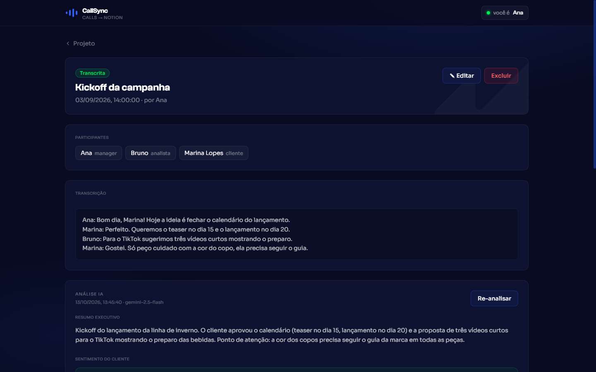
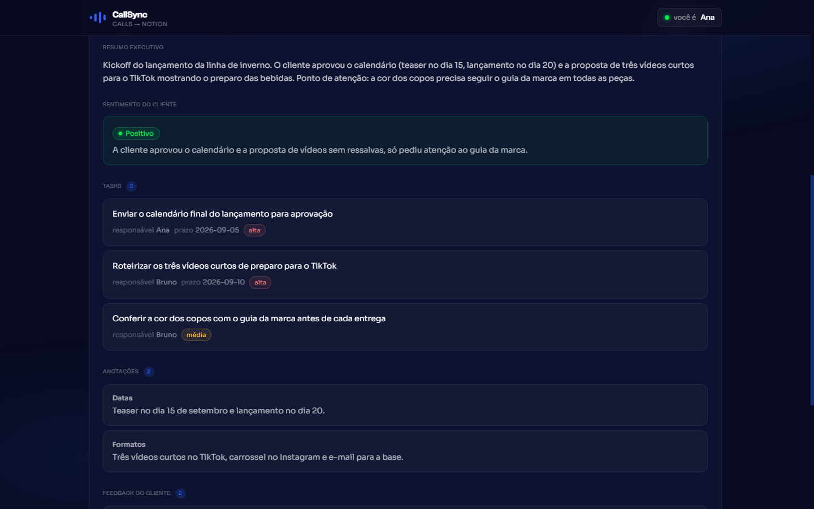
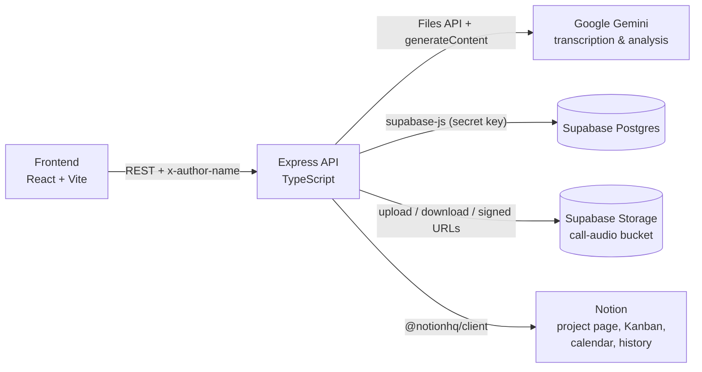

# CallSync

Turn client calls into structured notes, tasks and Notion pages: upload the recording (or paste a transcript), let Gemini transcribe and analyze it, review the output, then sync it to the project's Notion workspace.

## Overview

CallSync is a full-stack prototype for documenting client calls. It was originally built around a digital marketing agency's workflow: every client project has a series of calls, and after each one someone has to write a summary, list the action items, capture feedback and update the team's Notion.

CallSync automates that loop:

1. Create a client project (team, contacts, reference links, campaign docs).
2. Add a call, either as an audio file or a pasted transcript.
3. Transcribe the audio with Gemini.
4. Run an AI analysis that uses the project context and the previous calls.
5. Review the result and send it to Notion, where each project gets its own workspace.

The UI is in Brazilian Portuguese.

## Screenshots

<p align="center">
  
  
  
</p>

<sub>Local run with made-up sample data (fictional clients and calls).</sub>

## Features

**Projects**
- Create, edit and delete projects with client name, description, status, start date, planned post count, team (manager, analysts, strategists), client contacts, reference links and campaign documents.
- Project list with stats and filters by sentiment, manager and analyst.
- Project sentiment is kept up to date by a database trigger: it follows the latest analyzed call.

**Calls**
- Add a call by uploading audio (MP3, WAV, M4A, MP4 or WebM, up to 500 MB) or by pasting a transcript.
- Audio is stored in a private Supabase Storage bucket and played back through short-lived signed URLs.
- Edit call metadata and transcripts, or delete a call (its audio file is removed too).

**AI transcription and analysis** (Gemini `gemini-2.5-flash-lite`)
- Transcription uploads the audio to the Gemini Files API, waits for it to be processed, transcribes it in Portuguese with speaker labels, then deletes the remote file.
- Analysis returns structured JSON (enforced with a response schema):
  - executive summary
  - client sentiment (positive / neutral / negative) with a justification
  - tasks with optional owner, due date and priority
  - notes by topic
  - client feedback by topic, each with its own sentiment
- The prompt includes the project context and the summaries of up to 5 previous analyzed calls, so each analysis builds on the project's history.

**Notion sync**
- On a project's first sync, CallSync creates under a root page you choose: a project page, a **Kanban** database, a **Calendário de Posts** (posts calendar) database and a **Histórico de Calls** (call history) page. The IDs are stored on the project and a "Notion" link is added to its reference links.
- Each call produces a calendar entry, one Kanban card per task (status, priority, owner, manager, analysts, due date) and a history page with the summary, notes, feedback, tasks and transcript (very long transcripts are cut to fit Notion's 100-block limit per request).
- Two modes: send everything at once, or open a review modal and pick which items to send. Items already sent are flagged and can be rewritten.
- Calendar entries and Kanban cards with the same title are archived before being re-created, so re-syncing does not pile up duplicates.

**Attribution without accounts**
- There is no login. A "who are you?" picker lists the active rows of the `team_members` table; the choice is kept in `localStorage` and sent as the `x-author-name` header.
- The backend rejects writes whose author is not an active team member and stores the name on projects, calls, analyses and syncs.

## How it works



- The frontend only talks to the Express API. All Supabase, Gemini and Notion credentials stay on the server.
- The API uses the Supabase **secret key**, which bypasses Row Level Security.
- Transcription, analysis and Notion sync run inside the HTTP request; the UI shows a loading state until they finish.

### API

| Method | Path | Author header |
|---|---|---|
| `GET` | `/health` | |
| `GET` | `/api/team-members` | |
| `GET` / `POST` | `/api/projects` | POST |
| `GET` / `PATCH` / `DELETE` | `/api/projects/:id` | PATCH, DELETE |
| `GET` / `POST` | `/api/projects/:projectId/calls` (POST takes `multipart/form-data` with `audio` + `metadata`, or JSON with a `transcript`) | POST |
| `GET` / `PATCH` / `DELETE` | `/api/calls/:id` | PATCH, DELETE |
| `POST` | `/api/calls/:id/transcribe` | |
| `POST` | `/api/calls/:id/analyze` | yes |
| `GET` | `/api/calls/:id/notion-preview` | |
| `POST` | `/api/calls/:id/sync-notion` (`{ "items": "all" }` or a list of item IDs) | yes |
| `GET` | `/api/calls/:id/audio-url` (signed URL valid for 1 hour) | |

## Tech stack

| Layer | Technology |
|---|---|
| Frontend | React 18, TypeScript, Vite 5, Tailwind CSS v4, TanStack Query 5, React Router 6, react-markdown + remark-gfm |
| Backend | Node.js, Express 4, TypeScript (run with tsx), zod, multer, morgan |
| AI | Google Gemini `gemini-2.5-flash-lite` via `@google/genai` (Files API for audio) |
| Database and storage | Supabase (Postgres with triggers and RLS, Storage) via `@supabase/supabase-js` |
| Integrations | Notion API via `@notionhq/client` |

## Project structure

```
CallSync/
├── backend/            Express API (routes, Gemini and Notion services, env validation)
├── frontend/           React app (pages, components, API client and queries)
├── supabase/
│   └── migrations/     SQL migrations 0001 to 0007
├── scripts/            Live smoke tests (Node .mjs)
├── .env.example        Environment template (copy to .env at the repo root)
└── package.json        Root package with the smoke-test scripts
```

## Getting started

### Prerequisites

- Node.js 20 or newer (required by `@google/genai`)
- A Supabase project (use one dedicated to CallSync, see [Security notes](#security-notes))
- A Google Gemini API key ([Google AI Studio](https://aistudio.google.com/app/apikey))
- A Notion workspace where you can create an internal integration

### 1. Install dependencies

There are three packages: the root one (smoke-test scripts), the backend and the frontend.

```bash
npm install
cd backend && npm install
cd ../frontend && npm install
```

### 2. Configure the environment

Copy the template to `.env` **at the repository root**. The backend loads it from there (`backend/src/lib/env.ts`), and so do the smoke tests.

```bash
cp .env.example .env
```

| Variable | Required | Description |
|---|---|---|
| `GEMINI_API_KEY` | yes | Google Gemini API key. |
| `SUPABASE_URL` | yes | Project URL, e.g. `https://<project-ref>.supabase.co`. |
| `SUPABASE_PUBLISHABLE_KEY` | yes | Publishable key. Validated at startup; only used by `test:supabase`. |
| `SUPABASE_SECRET_KEY` | yes | Secret key used by the backend. Bypasses RLS, so keep it server-side. |
| `NOTION_API_TOKEN` | yes | Internal integration token. |
| `NOTION_ROOT_PAGE_ID` | yes | ID of the Notion page under which project workspaces are created (32 hex characters, with or without dashes). |
| `PORT` | no | API port. Defaults to `3002`. |
| `NODE_ENV` | no | `development` (default), `production` or `test`. |

The backend validates these with zod and exits with the list of invalid fields if something is missing.

The frontend calls `http://localhost:3002/api` by default. To point it elsewhere, set `VITE_API_BASE` in `frontend/.env.local` (Vite reads env files from the `frontend/` folder, not the repo root):

```env
VITE_API_BASE=http://localhost:3002/api
```

### 3. Set up the database

In the Supabase SQL Editor, run the migrations in this order:

| File | What it does |
|---|---|
| `0001_initial_schema.sql` | `projects`, `calls`, `call_analyses`, `notion_integrations`, `updated_at` triggers, RLS policies, and the `call-audio` Storage bucket with its policies |
| `0002_team_members_and_attribution.sql` | `team_members` table with three sample members, and `author_name` columns |
| `0003_project_sentiment.sql` | `projects.current_sentiment` / `last_analyzed_at`, kept in sync by a trigger |
| `0004_fix_sentiment_on_call_delete.sql` | Refreshes project sentiment when a call is deleted (cascade) |
| `0005_notion_call_sync.sql` | `notion_call_syncs` table (what was sent for each call) |
| `0006_notion_page_ids.sql` | Map of synced item to Notion page ID |
| `0007_projects_notion_page_id.sql` | Per-project Notion page, Kanban, calendar and history IDs |

**Team members.** Migration 0002 seeds three sample members (`Ana`, `Bruno`, `Carla`). There is no UI for managing them, so edit the `team_members` table in Supabase to add your team or deactivate someone (`active = false`).

**Storage.** Migration 0001 creates a private bucket named `call-audio` with a 500 MB file limit and audio MIME types (MP3, WAV, MP4/M4A, WebM). Check that it exists under Storage in the dashboard (`npm run test:schema` checks it too). Supabase also applies a project-wide upload size limit (Storage settings), which may be lower than 500 MB on your plan.

### 4. Set up Notion

1. Create an internal integration at [notion.so/profile/integrations](https://www.notion.so/profile/integrations) and copy its token into `NOTION_API_TOKEN`.
2. Create an empty page that will hold all project workspaces.
3. Connect the integration to that page: open the page, then `...` → **Connections** → add your integration.
4. Copy the page ID (the 32-character hex string at the end of the page URL) into `NOTION_ROOT_PAGE_ID`.
5. Optional: run `npm run test:notion` from the repo root to check access.

The first time a project is synced, CallSync creates its workspace under that page. The Notion API cannot set a database's view type, so switch the Kanban database to a Board view by hand if you want one.

## Running

Start the API and the web app in two terminals:

```bash
cd backend
npm run dev     # http://localhost:3002 (health check at /health)
```

```bash
cd frontend
npm run dev     # http://localhost:5173
```

For a production build:

```bash
cd backend && npm run build && npm start   # compiles to backend/dist
cd frontend && npm run build               # static files in frontend/dist
```

To type-check only, run `npm run typecheck` in either package.

## Smoke tests

There are no unit tests. `scripts/` holds live smoke tests that **talk to the real services configured in `.env`**. They create rows in your Supabase database and clean up after themselves, and the Gemini checks use API quota. Run them from the repo root against a development project, never against data you care about.

| Command | What it checks |
|---|---|
| `npm run test:gemini` | The API key works and `gemini-2.5-flash-lite` answers a ping. |
| `npm run test:supabase` | The publishable key connects and the secret key has admin access. |
| `npm run test:notion` | The token is valid and the integration can read the root page. |
| `npm run test:schema` | Migration 0001: inserts, check and unique constraints, the `updated_at` trigger, the private `call-audio` bucket, cascade deletes. |
| `npm run test:schema-0002` | Migration 0002: exactly the three seeded team members, unique names, `author_name` columns. Fails once you change `team_members`. |
| `npm run test:schema-0003` | Migrations 0003 and 0004: the project sentiment trigger across inserts, updates and deletes. |
| `npm run test:backend` | End to end through the API: health, author validation, project and call creation, a real Gemini analysis, update and cascade delete. Needs the backend running on port 3002 and an active team member named `Bruno`. |
| `npm run test:all` | Runs every check above except `test:backend`, which needs a running server. |

`node scripts/inspect-supabase.mjs` prints the public tables, up to 10 auth users and the Storage buckets of the configured project.

## Security notes

CallSync is a prototype meant to run locally or on an internal network. Read this before deploying it anywhere.

- **No authentication, by design.** Anyone who can reach the API can read and change every project, call and analysis. The `x-author-name` header is attribution, not identity: it is only checked against the list of active team member names.
- **CORS is open** (`cors()` with no options). Restrict it if the API is reachable from other origins.
- **The backend uses the Supabase secret key**, which bypasses RLS. Keep it on the server and never expose it to the frontend.
- **Use a Supabase project dedicated to CallSync.** The RLS policies grant full read and write access on every table, and on the `call-audio` bucket, to any `authenticated` user. Disable public sign-ups in Supabase (Authentication settings) or tighten the policies before putting anything sensitive in it.
- **Never commit `.env`.** It is in `.gitignore`; keep it that way, and rotate any key that ends up in version control.
- Uploads are held in memory by the API (up to 500 MB per file) before going to Storage, so size the server accordingly.

## License

[MIT](LICENSE) © 2026 João Cabral

## Author

**João Cabral**: [GitHub](https://github.com/thxcabra) · [LinkedIn](https://www.linkedin.com/in/joao-cabral-machado/) · [Portfolio](https://thxcabra.github.io/portfolio/#/projetos/5)

---

## Resumo em português

O CallSync é um protótipo full-stack para documentar calls com clientes. Você cria um projeto, adiciona uma call (upload de áudio ou transcrição colada), o Gemini transcreve e gera uma análise estruturada (resumo, sentimento do cliente, tarefas, anotações e feedback) e, depois de revisar, você envia tudo para o Notion: cada projeto ganha uma página com Kanban, Calendário de Posts e Histórico de Calls, criados automaticamente na primeira sincronização.

Stack: React, Vite e Tailwind no frontend, Express e TypeScript no backend, Supabase (Postgres e Storage), Google Gemini e API do Notion. Não há login: a atribuição é feita pelo nome escolhido na lista de `team_members`. Para rodar, copie `.env.example` para `.env` na raiz, aplique as migrations de `supabase/migrations` em ordem e siga o passo a passo acima.
